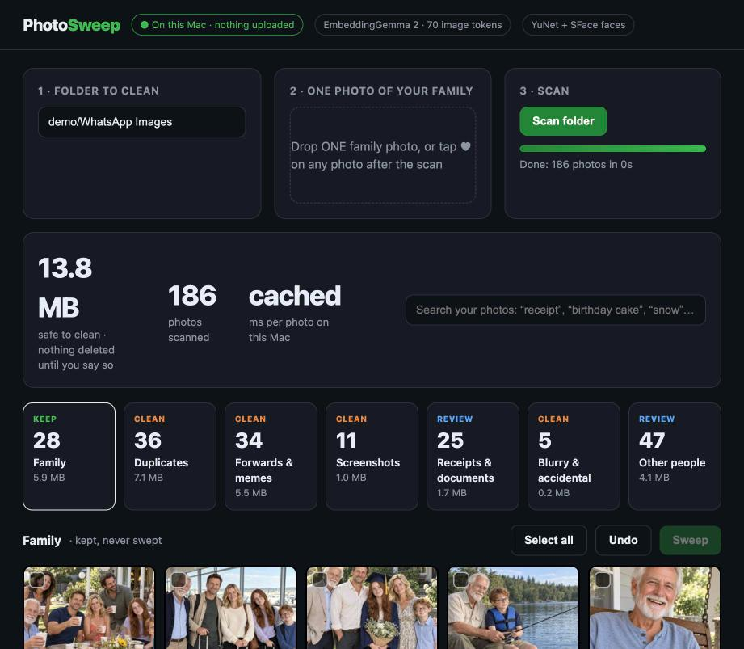

# Photo Sweep: on-device photo cleanup with EmbeddingGemma 2

Clean the "good morning" forwards, memes, screenshots, receipts, blurry shots and duplicates out of a WhatsApp photo folder, keep
every family photo, and find the whole family from **one** photo. Everything runs on your own machine: no upload, no API key.



Built on Google's [EmbeddingGemma 2](https://huggingface.co/google/embeddinggemma-2) (740M, text + images in one embedding space)
plus two small open face models from [opencv_zoo](https://github.com/opencv/opencv_zoo) (YuNet to find faces, SFace to compare them).

## Measured results (158-photo test set, MacBook Pro M4 Pro)

| | Result |
|---|---|
| Speed, EmbeddingGemma 2 at 70 image tokens, Mac GPU | **85 ms per photo** (556 ms at the default 280 tokens) |
| Family photos kept, no training | **29 of 29** |
| Junk kept by mistake, no training | 1 of 77 |
| Whole family found from ONE photo (faces) | **97.4%**, other families wrongly kept 0.8% |
| Junk-or-keep after you tag 20 photos | **96.9%** accuracy, on the device |
| Same task, best cloud decision model (Perplexity Decider, photos uploaded) | 100% |
| Near-duplicates (burst shots, re-forwards) | clean split: real copies >= 0.918 cosine, different photos <= 0.896 |
| Clustering with no labels (k-means, 256 dims) | ARI 0.866, purity 0.911 |
| **Ask your files**: right file first, 30 questions on a Downloads folder | **30 of 30** (macOS Spotlight: 5, file-name search: 12) |
| Answers from the found files, Gemma 4 E4B on the Mac | 11 of 11, median 2.0 s (busy Mac) |
| Electricity bills: find, read, add up (AI reads, code calculates) | 12/12 bills exact; one-prompt total was wrong |
| **Find anyone by name**: name 5 faces in ONE photo (ArcFace) | **114 of 121** family appearances found, **0** wrong names; 118/121 after 2 more clicks |
| Vector store for one folder | numpy, ChromaDB, sqlite-vec, pgvector all 29/30; keep it simple |

Full method, every table and the caveats: **[REVIEW.md](REVIEW.md)**.

## Run the app

```bash
uv venv .venv --python 3.12 && uv pip install --python .venv/bin/python -r requirements.txt
./get_models.sh                                   # YuNet + SFace + ArcFace (EmbeddingGemma 2 downloads itself, ~1.5 GB)
.venv/bin/python app/make_demo.py                 # builds demo/WhatsApp Images (186 files) from the test set
.venv/bin/python app/server.py "demo/WhatsApp Images"
open http://127.0.0.1:8765
```

**Ask your files** tab: index a folder (`rag/make_downloads.py` builds a fictional Downloads folder), then ask "where's my latest electricity bill?".
Answers come from Gemma 4 E4B (`mlx-community/gemma-4-E4B-it-qat-4bit`, downloaded on first question).

1. Scan the folder. 2. Tap ♥ on one family photo (or drop one in). 3. Review the piles and press **Sweep**: files move to
`<folder>/_Sweep/<pile>/`, and **Undo** puts them back. Nothing is ever deleted by the app.

**Find anyone by name**: hover a photo, click 👤, click a face, type a name, Enter. Then type the name in the search box
("Lily", "Max birthday", "whole family"): it checks every face on the Mac and lights up that person's photos. Names stay in
`<folder>/.photo-sweep/people.json`. ArcFace R50 comes from InsightFace's buffalo_l pack; its weights are licensed for
non-commercial use only. Teach it from your own library with `agent/people.py` (groups, cross out wrong faces, hide groups).

Point it at your own folder (for example WhatsApp Desktop's media folder, or Downloads) by typing the path in step 1.

## Reproduce the benchmarks

```bash
.venv/bin/python bench/fetch_public.py            # real receipts (CORD-v2) + real strangers (Flickr30k) via the HF datasets-server
.venv/bin/python bench/make_local.py              # phone screenshots (headless Chrome) + accidental shots
.venv/bin/python bench/bench.py mps 70            # zero-shot piles, "my people", duplicates, search, Matryoshka, speed
.venv/bin/python bench/bench.py mps 280
.venv/bin/python bench/cluster.py 70              # k-means / agglomerative vs true groups
.venv/bin/python bench/faces.py                   # YuNet + SFace, k marked family photos
.venv/bin/python bench/oneshot.py                 # find the family from ONE photo
.venv/bin/python decide/probe.py && .venv/bin/python decide/control.py && .venv/bin/python decide/full.py   # decision models (OpenRouter key)
.venv/bin/python rag/make_downloads.py && .venv/bin/python rag/eval.py   # ask your files vs Spotlight
.venv/bin/python rag/answer.py --contexts && .venv/bin/python rag/answer.py --eval mlx-community/gemma-4-E4B-it-qat-4bit
.venv/bin/python rag/stores.py                    # numpy vs ChromaDB vs sqlite-vec vs Postgres + pgvector
.venv/bin/python rag/make_bills.py && .venv/bin/python rag/analyze.py   # electricity trend + bank savings
```

`agent/live.py` is an early, experimental live index (watches folders, re-indexes a file when it is saved, skips secrets and
dependencies). Not measured yet.

## Test set

| Folder | n | What | Source |
|---|---|---|---|
| `data/family` | 29 | the family to keep: one fictional American family of 5 | generated with Codex from `data/refs/us_family_sheet.jpg` |
| `data/other_family` | 12 | two other fictional families (hard negatives) | Codex |
| `data/junk/codex_*` | 22 | greetings, memes, quotes, flyers, chain messages (fictional brands) | Codex |
| `data/other_people` | 40 | real photos of strangers | Flickr30k test split, **not shipped**, fetched by script |
| `data/junk/receipt` | 25 | real receipts | CORD-v2 (CC BY 4.0), **not shipped**, fetched by script |
| `data/junk/screenshot` | 20 | phone screenshots | regenerated by `bench/make_local.py` |
| `data/junk/accidental` | 10 | pocket shots, blur | regenerated by `bench/make_local.py` |

All people in the generated images are fictional. Prompts are in `data/prompts/`; `bench/codex_gen.py` regenerates them with any
Codex CLI signed in with a ChatGPT plan.

## On phones

Google ships `embeddinggemma-2-text-vision-440m.litertlm` (388 MB) for MediaPipe `UniversalEmbedder` on iOS and Android, and YuNet +
SFace run through OpenCV. The plan for a Flutter demo (iPhone first), with what is confirmed and what is not:
[docs/mobile-feasibility.md](docs/mobile-feasibility.md).

## Limits

- 158 photos, one run. Thresholds (face 0.5, duplicates 0.93, forwards margin 0.045) were chosen on this set: test on your own photos.
- The families are generated images; real faces differ more from each other than generated ones (see REVIEW.md, section 3).
- Zero-shot puts many real stranger photos in the wrong pile; they are never kept as family, but tag a few photos for better piles.

## License

Code: Apache 2.0. Generated images in `data/` and `docs/`: CC BY 4.0. EmbeddingGemma 2 is under its own license (Apache 2.0 per its
model card); YuNet (MIT) and SFace (Apache 2.0) are downloaded from opencv_zoo, not redistributed.

By [Anass Kartit](https://www.kartit.net).
